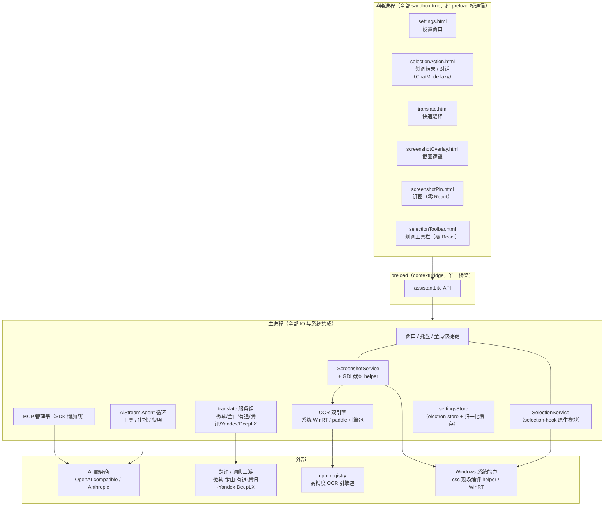

# 系统架构全景 (Architecture Overview)

> 本文只记录"看代码看不出来"的内容：系统全景、模块职责边界、跨模块依赖规则与关键数据链路。函数级细节以源码为准。
> 更新时机：进程模型、模块边界或核心数据流变化时（并按 AGENTS.md 的文档同步红线执行）。

## 1. 系统全景架构

## 2. 模块划分与依赖边界

- **`src/renderer/`（渲染进程）**：6 个 HTML 入口对应 6 个窗口。只通过 `window.assistantLite`（preload 暴露）与主进程通信，**没有任何直连 Node 或网络的能力**（sandbox 开启）。共享微交互原语集中在 `src/renderer/ui/`（`SegmentedControl`、`StatusChip`、`WavyProgress`、`ShapeBadge`），设置外观工坊组件位于 `src/renderer/settings/AppearanceStudio.tsx`，对话过程折叠与行级 diff 统计纯函数位于 `src/renderer/chat/turnCollapse.ts` 与 `diffStats.ts`。工具栏与钉图窗口刻意保持零 React 纯内联 JS，以求毫秒级打开（其中 `selectionToolbar.html` 通过 `app.resolveThemeVars` 同步注入完整主题 CSS 变量）；其余窗口共享 React（Rollup 自动抽共享 chunk）。新功能不加 HTML 入口，用 `React.lazy` 组件挂进现有窗口。
- **`src/preload/`（唯一桥梁）**：`contextBridge.exposeInMainWorld('assistantLite', api)`，全部 IPC 调用的类型出口（`AssistantLiteApi`）。事件监听一律返回退订函数。渲染器代码出现 `ipcRenderer` 即为越界。
- **`src/main/`（主进程）**：所有文件、网络、系统集成与常驻状态的归属地。按域分文件（`SelectionService`、`ScreenshotService`、`ocr/`、`translate/`、`agent/`、`mcp/`、`ai/`），IPC 注册集中在各域的 register 函数与 `index.ts`；`selectionWindowPolicy.ts` 集中子窗口复用选址、兄弟窗错位与坐标/命中校验纯逻辑，`iconTiers.ts` 提供多 DPI 物理像素匹配的托盘与窗口位图档位。
- **`src/shared/`（双端共享）**：类型定义、IPC 通道名常量、纯函数（设置归一化、多主题色彩派生 `theme.ts`、翻译语言映射、上下文计量等）。**禁止 import electron 或 Node API**——它被 vitest 直接测试，也被渲染端引用。
- **依赖方向规则**：renderer → preload API → main；shared 被三者引用但不引用三者。主进程域模块之间允许调用，但设置读取统一走 `settingsStore.getSettings()`（带归一化缓存），禁止各自直读 electron-store。
- **便携版用户数据目录**：`appIdentity.ts` 检测到 electron-builder portable 启动器注入的 `PORTABLE_EXECUTABLE_DIR` 时，在任何 `getPath('userData')` 之前把 userData 重定向到 exe 同目录的 `data/`，并跳过旧版 `%APPDATA%` 目录的迁移（否则系统里的旧配置会覆盖随包预置）；安装版与开发模式保持 Electron 默认路径。`scripts/prepare-portable-preset.mjs` 按白名单把设置、`memory.md` 与 `skills/` 复制进 `dist/data/`，聊天历史、生词本、缓存一律排除。

## 3. 关键数据流向 (Core Data Flow)

- **划词问答**：`selection-hook`（原生全局钩子）→ `SelectionService`（主进程，`hasUsableSelectionRect` / `isPointInsideToolbarHitbox` 校验 + 指针按下防误隐藏 + `pendingToolbarShow` 就绪握手）→ 划词工具栏窗口（冷加载经 `IPC.SelectionGetInitialSelection` 同步拉取；Windows 热复用窗口在 show 前必须做一次真实几何变化——`height+1` 再还原——以逼 Chromium 恢复隐藏时被清掉 `WS_VISIBLE` 的 render-widget 子窗口，否则热工具栏能画出来但会吞掉全部点击，表现为"只有重启后第一次点得动"）→ 用户选动作 → `SelectionProcessAction` / `WindowOpenNew` IPC → 复用未置顶 action 窗口或错位新建兄弟窗口（`selectionAction.html`，关闭隐藏时派发 `IPC.SelectionReset` 清场，Windows 经瞬时 `'screen-saver'` 置顶抬升绕过前台锁限制）→ `AiStream` IPC → 主进程 Agent 循环调 AI 服务商 → chunk 流式回传。
- **截图识别文字**：热键 → `ScreenshotService.startCapture` → GDI helper exe（`csc.exe` 现场编译，写临时 PNG，读入内存后立即删除）→ 全屏遮罩选区 → confirm 后主进程裁剪 → 按 `settings.ocrEngine` 分发：系统引擎（`WinRtOcr.exe`，PNG 走 stdin）或 paddle 引擎包（userData 内按需下载）→ 文本进剪贴板 + toast。
- **快速翻译与语音合成**：回车 → `translate:run` → 主进程**并行**执行所有启用服务（每服务独立 15s 超时与 AbortController）→ 逐服务回 `translate:chunk` → 渲染层按 `serviceId` 更新卡片；中英文双向智能互切；词典卡片附带生词本自动收录钩子；底部提供共享 `AiStream` 的语境追问/地道润色条；多实例翻译窗由主进程 `translateWindows` 集合管理（保留已置顶窗、错位新开）；全局语音合成（TTS）根据设置调度 Edge TTS 或小米 MiMo 大模型规范播音服务。
- **Agent 工具调用与执行流**：模型工具调用 → 未闭合 JSON 启发式参数流式解析（`parseStreamingToolArgs`）与实时字符计数/展开动效 → 基于 `(round, index)` 轮次物理隔离的稳定 Call ID 派发 → `validateAgentToolArgs` → 连续只读工具并发批处理（`Promise.all`）加速读取 → 细粒度风险分级（内置与 MCP 工具均评估：`forbidden` 毁灭性指令直接拦截 / `dangerous` 危险操作即便在全权限模式也强制暂停审批 / 普通操作全权限自动放行）→ 动态防幻觉守护（拦截虚假测试报告与无工具调用的伪完成声明）→ 编辑后验证引导（自动提示跑测试/构建检查）→ 执行并落盘快照（可回退）与工具输出（截断至 12k 回传）；主进程全局未捕获异常/拒绝拦截与 IPC 4000 字符流式文本有界截断保证进程常驻稳定。读取类工具（`read_file` / `list_dir` / `search_files`）以工作目录为声明的操作范围：越界或命中敏感文件名时暂停审批，`search_files` 直接跳过敏感文件内容（结果里说明），避免搜索成为读取审批的旁路；`run_command` 以单个 argv 交给目标 shell（不再经 cmd.exe 二次拼接命令行），abort/超时按进程树终止。forbidden/dangerous 黑名单覆盖 `rm` 长选项与尾注变体、引号盘符 `del`、`rd/rmdir` 递归删盘内路径、`reg(.exe) import` 与 PowerShell 破坏性等价物（Stop-Computer/Format-Volume/Clear-Disk/vssadmin 等）；敏感文件名模式含 shell 历史、kube/gnupg/docker 凭据、gcloud、pypirc 等。
- **对话上下文与历史压缩流**：默认注意力预算 200k tokens（保留区 85% ~170k，触发线 95% ~190k）；长任务单轮/多轮采用死锁破局退避，在发送前或用户点击输入框左下角圆环就地压缩；旧历史经由结构自愈的 `IPC.AiSummarize` 提炼为 5 节复工文档（Recap Doc），若指定压缩模型 404 则无缝降级当前聊天模型；UI 视图完整保留全部轮次，线路层以「复工文档 + 保留区轮次 + 刚输入指令」按需组装重放。

## 4. 核心抽象与设计模式

- **IPC 契约三件套**：`shared/ipc.ts` 通道名常量 + `shared/types.ts` 载荷类型 + preload 的类型化封装。新增通道必须三处同步（如系统主题强调色 `IPC.AppSystemAccentGet` / `IPC.AppSystemAccentGetSync` / `IPC.AppSystemAccentChanged`、设置同步初始化 `IPC.SettingsGetSync`、划词工具栏同步拉取 `IPC.SelectionGetInitialSelection`、隐藏清场 `IPC.SelectionReset`、多开子窗 `IPC.WindowOpenNew`）。
- **设置归一化**：`shared/actions.ts` 的 `normalizeSettings` 是所有设置读取的唯一入口（mergeSettings + 字段级白名单），损坏的 settings.json 不应导致崩溃；`settingsStore` 缓存归一化结果，仅在写回时失效；动作快捷键按 `action.id` 运行时读取最新设置。
- **Seeded 多主题派生与分级图标**：`shared/theme.ts` 的 `deriveThemeCssVars` 按 `theme` / `pureBlack` / `primaryColor`（含系统强调色回退）/ `colorStyle`（`vivid` / `tinted` / `soft` / `monochrome`）实时计算四级明度表面与独立语义状态 CSS 变量，由 React 窗口经 `useThemeMode` 注入并结合 `chatColorMode`（`semantic` / `theme` / `minimal`，`monochrome` 下收敛为 `minimal`）设置 `data-chat-color`，同时同步至零 React 的 `selectionToolbar.html`（`app.resolveThemeVars`）；`main/iconTiers.ts` 为不同 Windows DPI 托盘与窗口尺寸提供精确匹配的矢量栅格化 PNG 档位。
- **词典数据快照**：`DictEntry` 是生词本保存的最小完整快照（音标/释义/词形，有道额外含短语与例句）；显示层裁剪（如释义取前 3 条）只发生在渲染层，快照保存完整数据。
- **可选重能力 = 按需下载**：高精度 OCR 引擎包不随安装包分发，运行时从 npm registry 拉取（sha512 校验 + 系统 tar 解包 + `engine.json` 原子标记）到 userData；加载用「变量说明符 + `@vite-ignore`」的运行时动态 import 绕过 CJS/ESM 边界。
- **Windows 原生能力 = 零依赖 helper**：截屏与系统 OCR 都用「C# 源码常量 + 本机 .NET Framework csc.exe 现场编译 + 缓存到 userData/bin」模式；WinRT 互操作不用 `System.Runtime.WindowsRuntime` 的 await 扩展（类型身份是 Win8 单体 winmd，Win10/11 编译不过），用 `Completed` + `GetResults()` 阻塞等待。

## 5. 外部依赖与集成点

- **AI 服务商**：OpenAI-compatible（`/chat/completions` 流式）与 Anthropic；请求层统一采用 Node 原生 / undici 栈（挂接全局 dispatcher，配置 64 连接池、15s 连接超时与 30s Headers Timeout），零 Chromium 跨进程 IPC 缓冲，支持 `[DONE]` 毫秒级流终止与指数退避重试；渲染器仍通过 Chromium 代理。
- **渲染视图与实时预览**：代码块采用 highlight.js 高亮与自适应高度折叠，HTML/SVG 支持无缝切入独立沙箱 iframe 实时预览与全屏覆盖，采用虚拟隐藏与 DOM 缓存杜绝 RenderFrame 重建卡顿；预览帧为 opaque origin（刻意不授予 `allow-same-origin`，srcdoc 继承父源后能经 `window.parent` 拿到 contextBridge）。
- **翻译/词典/TTS 上游**：均为 Web API，各自需要签名或固定请求头；Edge TTS 补充请求头防盗链绕过，小米 MiMo TTS 走 OpenAI 兼容聊天补全端点合成音频；有道 dictvoice 音频有防盗链，经主进程代理换 data URL。
- **MCP**：`@modelcontextprotocol/sdk` 懒加载（首次连接才 import），自动向 stdio 子进程与远程 MCP 注入系统/应用网络代理、清洗嵌套 `cmd /c` 与补充 `-y` 参数、实时捕获 stderr 管道排查日志，并支持行内配置可视化修改与热重载。工具注册时对 sanitize 后重名的工具名加 `__N` 后缀，调用不会误路由到先连接的 server。
- **聊天持久化**：分片存储——`chat-topics/<topicId>.json` 每话题一文件 + `index.json` 记侧栏顺序。启动时 `chat:load-topic-summaries` 只返回元数据（标题、时间、置顶、session 等，`turns` 为空），打开话题时再通过 `chat:load-topic` 读取该分片正文；渲染端只保留最近 8 个已加载话题（活动/运行中的话题不淘汰）。保存通过 `chat:save-topic-changes` 只传「新顺序 + 已加载/变更话题正文」，主进程按 baseDir 维护串行队列（同 id 后到覆盖、旧全量快照优先替换基线），只重写变更分片与索引（tmp+rename 原子落盘）；重命名/置顶/自动命名走 `chat:update-topic-meta`，只改元数据、不搬运正文。分片布局未就绪或新顺序缺少正文时返回 `needsFull`，仅在全部正文都在内存时回退全量保存；旧版单文件 `chat-topics.json` 仍按原逻辑迁移并退役为 `.bak`。

- **OS 集成**：`selection-hook`（划词，Windows/macOS 双实现）、`csc.exe` 编译的 helper、`Windows.Media.Ocr`、系统托盘与全局快捷键。交给系统外壳的链接只有 `app:open-external` 一条通道且只放行 http(s)/mailto（Windows 的 `shell.openExternal` 会执行盘符路径与 `file:` 指向的 .lnk/.exe）；`will-navigate` 一律阻止，仅放行当前文档重载。

## 6. 技术债务与已知取舍

- **主进程依赖散装进 asar**（`externalizeDepsPlugin`，约 3,500 文件）：改为捆绑可再减体积并小幅加快冷启动，但 MCP/undici/conf→ajv 打包有坑，已决定推迟。
- **ChatMode 单文件约 2,400 行**：已做消息体级 memo 化，完整按域拆分等新功能页面需求明确后进行。
- **darwin 引擎包路径未实机验证**：引擎包 manifest 支持 macOS，但没有 macOS 机器跑过完整下载→加载→识别链路。
- **速度 vs 内存取舍**：设置窗口、划词结果窗口、聊天窗口、快速翻译主窗口关闭均为隐藏 + 60s 闲置后销毁（工具栏为 30s；保留秒开体验，不再常驻渲染进程；彻底禁用/退出走 destroy 直接释放）；销毁前检查该窗口是否还有活跃 AI 请求，有则顺延一个周期，避免长任务被静默中断。划词工具栏、动作窗口与翻译窗口隐藏复用时启用 `backgroundThrottling: false` 并监听 `render-process-gone` 自愈销毁，同时在隐藏前发送 `IPC.SelectionReset` 中止旧流并复位表单，兼顾瞬时开启、进程唤醒稳定与干净会话隔离。托盘常驻依赖 `window-all-closed` 处理器，勿删。
- **审批门禁：sender 校验 + 主进程原生确认（纵深防御，未根治）**：`agent.approveTool` 校验审批必须来自发起流的窗口（callId 随工具事件广播，全窗口共用 preload，仅凭 callId 不构成授权）；`settings.update` 对两条静默能力升级弹主进程原生确认——开启 `agentFullAccess`、新增/变更 MCP stdio 命令（拒绝只剥除补丁对应部分）；`proxyUrl` 因输入框每键一存无法弹窗，仅做无效 URI 容错。残留面：聊天窗口自身被 XSS 时 sender 校验同样通过（根治需把确认移出渲染进程之外的可信通道），渲染器靠 CSP（六入口已加）+ 转义压低注入概率。
- **MCP 工具名空间**：server 名清洗后可能同名（如 "a b" 与 "a_b"），工具注册/改名时对已占用名加 `__N` 后缀保证模型侧唯一，调用不再误路由到先连接者。Windows 上 stdio 命令仍经 `cmd /c` 重组（`.cmd` 脚本必须如此），token 内的 cmd 元字符理论上可被二次解析——连接前的原生确认弹窗即针对此面的缓解。
- **`--max-old-space-size=512`**：为 4K 截图 dataUrl 预留的有意上限，非泄漏症状。
